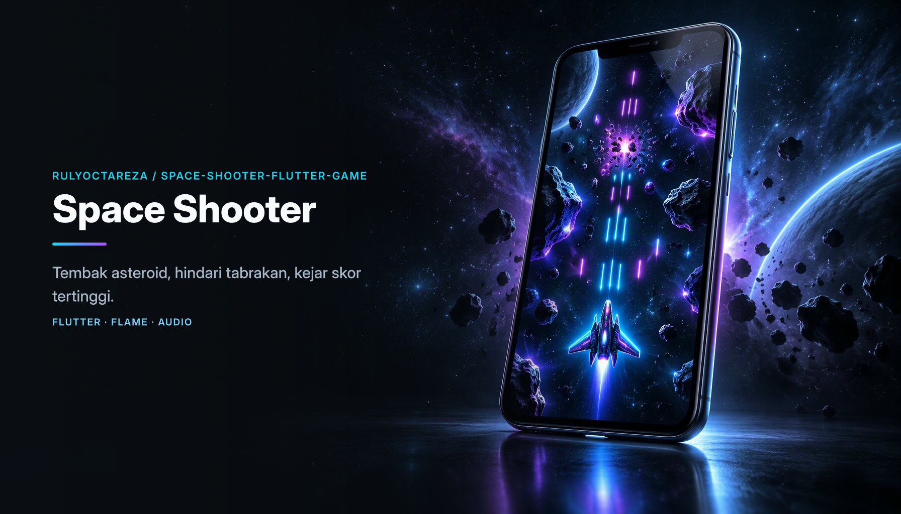
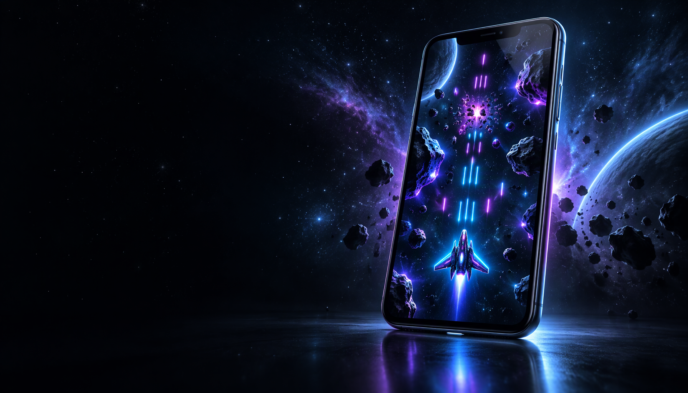

<p align="center">
  
</p>

<h1 align="center">Space Shooter</h1>

<p align="center">
  <b>Tembak asteroid, hindari tabrakan, kejar skor tertinggi.</b><br>
  Flutter · Flame · audio
</p>

<p align="center">
  <a href="https://flutter.dev"></a>
  <a href="https://flame-engine.org"></a>
  
</p>

---

## ✨ Preview

<p align="center">
  
</p>

> **Catatan:** gambar di atas adalah *ilustrasi konsep*, bukan screenshot asli.

---

## 📖 Tentang

Game space shooter vertikal yang dibangun dengan Flame: pesawat pemain menembak asteroid yang
terus berdatangan, dengan efek ledakan, partikel, parallax background, serta menu start dan
layar game over.

---

## 🌟 Fitur

- 🚀 **Pesawat pemain** dengan sistem tembakan (`bullets.dart`)
- ☄️ **Asteroid** dan spawner
- 💥 **Ledakan & partikel** (`explosion.dart`, `blast_particle.dart`)
- 🌌 **Parallax background**
- 🏁 **Start menu** dan **game over overlay**
- 🔊 **Efek suara** dengan `flame_audio`

---

## 🛠️ Tech Stack

| Area | Pilihan |
|---|---|
| Framework | Flutter |
| Game engine | Flame |
| Audio | `flame_audio` |

---

## 🧱 Struktur

```text
lib/
├── components/
│   ├── ship.dart
│   ├── asteroid.dart
│   ├── bullets.dart
│   ├── explosion.dart
│   ├── blast_particle.dart
│   └── bg_parallax_component.dart
├── pages/
│   ├── my_flame_game.dart
│   ├── start_menu_overlays.dart
│   └── game_over_overlay.dart
└── main.dart
```

---

## 🚀 Menjalankan

```bash
flutter pub get
flutter run
```

---

## 🧪 Testing

```bash
flutter analyze
flutter test
```
